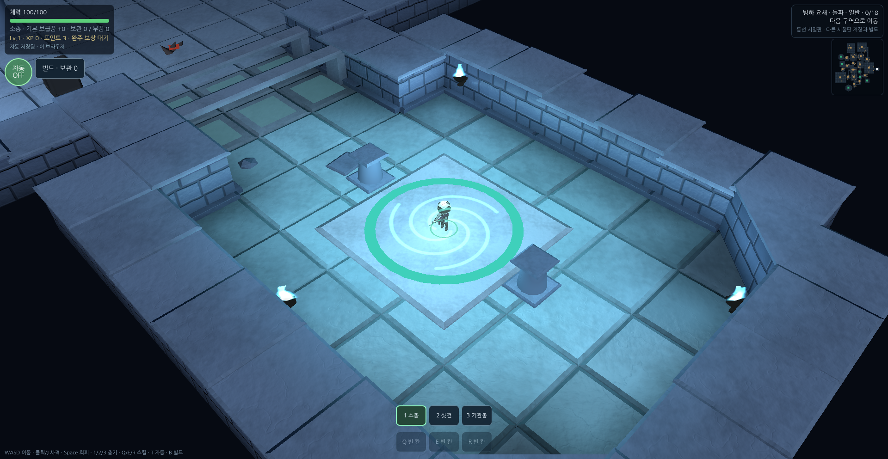
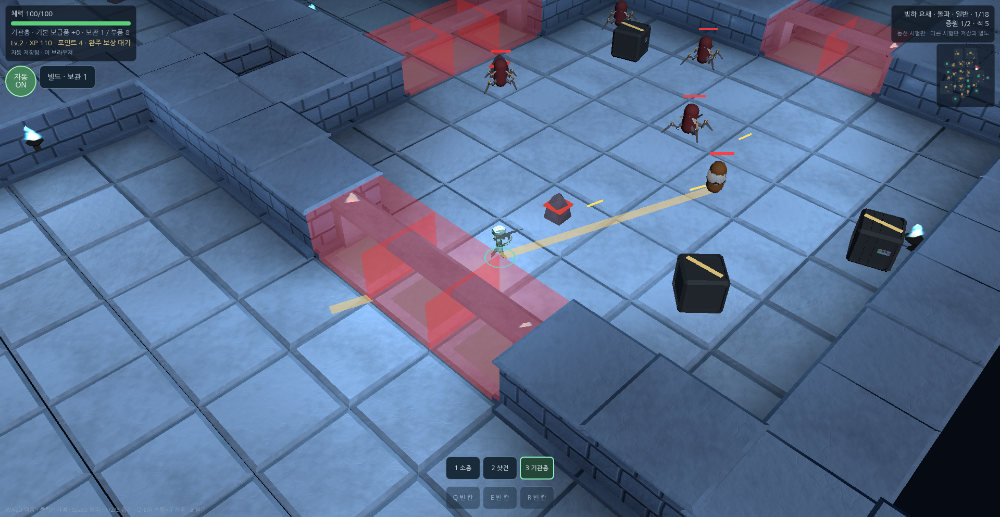
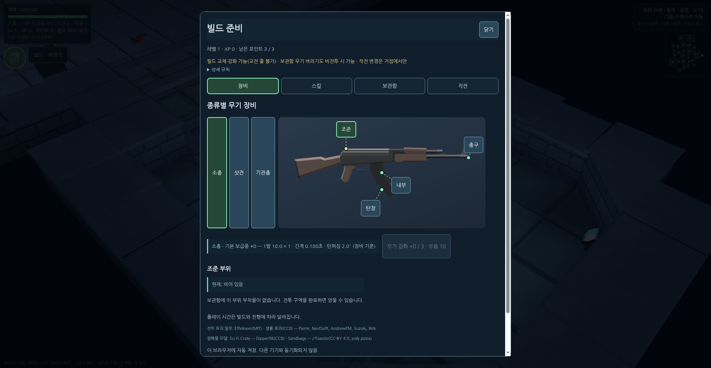
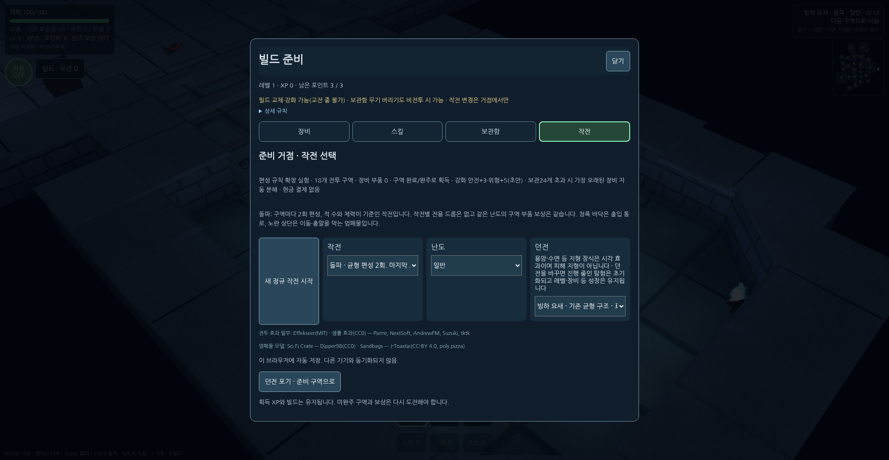

# Grid Breach

Three.js로 만든 3D 던전 크롤러 슈터입니다. 절차 생성 던전을 돌파하면서 총기를 부착·강화하고 스킬을 키우는 브라우저 게임으로, 별도 설치 없이 GitHub Pages에서 바로 플레이할 수 있습니다.

**플레이:** https://sigco3111.github.io/grid-breach/

## 주요 기능

- **던전 5종 (절차 생성)** — 시드 기반으로 매번 다른 구조가 생성됩니다.
  - 빙하 요새: 기존 균형 구조 · 표준 동선
  - 용융 주조소: 순환로 다수 · 측면 우회와 포위 · 증원 1회 추가 · 근접 난전
  - 고대 전당: 깊은 직선 원정 · 넓은 전당 · 슈터 비중 높은 사선 싸움 · 정예 구역 4곳
  - 침수 미로: 좁은 통로의 단거리 미로 · 같은 구역도 경로가 여럿
  - 균열 심연: 분기와 순환이 섞인 탐험형 · 클리어 순서 선택 폭이 큼 · 보물 구역
- **작전 3종** — 돌파(균형 편성, 마지막 보스까지), 방어망 소탕(연속 증원·자원 파밍), 정예 추적(적은 수의 정예 호위). 난도 선택을 지원합니다.
- **총기 성장** — 소총·샷건·기관총 3종, 부위별 부착(조준·총구·탄창·내부), 강화(+3), 옵션 부여. 부품은 전투 구역 완료 보상으로 얻습니다.
- **보관함** — 부착물을 모아 두고 비전투 상태에서 교체합니다. 장비 보관 24개를 넘기면 가장 오래된 장비가 자동 분해되고, 부착물이 넘치면 임시수령함으로 이동해 손실 없이 수령할 수 있습니다.
- **스킬 트리** — 레벨로 얻는 포인트를 총기·생존·드론 계열에 배분하고, Q/E/R 슬롯에 능동 스킬(공격 드론·회복 드론·터렛 등)을 배치합니다.
- **자동 사냥** — T 키로 전투·이동을 자동 수행하는 모드를 켤 수 있습니다.
- **자동 저장** — 브라우저(localStorage)에 자동 저장됩니다. 저장이 손상되면 백업에서 복구하고, 읽지 못하는 저장을 새 진행으로 자동 덮어쓰지 않습니다.

## 실행 화면

실제 배포 주소에서 직접 캡처한 화면입니다.

| 던전 진입 | 자동 전투 |
|---|---|
|  |  |

| 빌드 준비 · 장비 | 빌드 준비 · 작전 선택 |
|---|---|
|  |  |

## 플레이 방법

- **이동** WASD · **사격** 클릭/J · **회피** Space
- **총기 전환** 1/2/3 · **스킬** Q/E/R
- **자동 사냥** T · **빌드 준비** B
- 전투 구역에 들어서면 문이 잠기고, 증원을 모두 정리하면 열립니다. 구역을 완료해 부품·보상을 얻고, 준비 구역(B)에서 장비와 스킬을 정비한 뒤 다음 구역으로 진행합니다. 창고 교체·강화는 교전 중에는 불가합니다.

## 설치 · 실행

- **플레이:** 위 Pages 링크를 브라우저에서 열면 바로 실행됩니다(설치 불필요). 진행은 같은 브라우저에 자동 저장되며 다른 기기와 동기화되지 않습니다.
- **저장소 구성:** `main` 브랜치는 이 프로젝트의 출발점인 3인칭 슈터 프로토타입 소스(Vite + Three.js, `npm install` 후 `npm run dev`)를 담고 있고, 현재 서비스되는 Grid Breach 빌드는 `gh-pages` 브랜치에 버전별 단일 HTML(`play/NN-visual-lab.html`)로 배포됩니다.

## 기술 내용

- **언어·런타임:** JavaScript(ES 모듈), 브라우저 단일 페이지
- **렌더링:** three.js — 던전 지형·캐릭터·조명·미니맵, 3D 총기 프리뷰(환경맵 반사)
- **전투 효과:** Effekseer — 총구 화염·폭발 등 파티클 효과
- **던전 생성:** 시드 기반 절차 생성(`play/dgen.mjs`, threejs-procedural-dungeon에서 가져와 수정). 방·통로 그리드, 순환로, 정예·보물 구역 배치
- **자동 주행:** BFS 경로 탐색으로 다음 전투 구역까지 이동하며, 장판 등으로 목표 셀이 막힌 경우 가장 가까운 유효 셀로 보정
- **배포:** esbuild로 에셋을 포함한 단일 HTML 번들을 만들어 GitHub Pages에 게시
- **검증 도구:** 게임 내 자동 사냥 모드를 구동하는 헤드리스 프로브(Puppeteer, 고정 20fps 시뮬레이션)로 던전 동선·문 잠금 해제·전투 완주를 자동 확인

## 검증 범위와 알려진 한계

- 5개 던전의 동선(방 개시→문 잠금→해제)과 전투 진행은 게임 내 자동 사냥 모드 기준 고정 20fps 시뮬레이션으로 확인했습니다. 이 검증은 실제 기기의 프레임·터치 조작·사람 체감 난이도를 대신하지 않습니다.
- **용융 주조소의 사람 기준 난이도는 미확정입니다.** 이 던전은 구역당 증원이 한 번 더 붙는 편성(게임 내 안내에 표기된 초안조정값)이라, 자동 사냥 기준으로는 소모전이 길어지는 구간이 확인됐습니다. 실제 플레이 피드백을 받아 조정이 필요하면 반영합니다.

## 라이선스 · 원작 표기

- 코드는 MIT 템플릿(SoldierThirdPersonThreeJS, achrefelouafi)에서 출발해 수정했습니다. [LICENSE](LICENSE) 참고.
- 에셋 출처와 라이선스는 [ASSET-SOURCES.md](ASSET-SOURCES.md)(프로토타입 에셋)와 `gh-pages` 브랜치의 `play/ASSET-SOURCES.txt`(현행 빌드 에셋)에 정리돼 있습니다.
  - three.js (MIT) · 던전 생성기 원형 threejs-procedural-dungeon (MIT) · Effekseer (MIT) · 샘플 효과 (CC0) — Pierre, NextSoft, AndrewFM, Suzuki, tktk
  - 총기 모델: Quaternius Low Poly Guns 계열 (CC0)
  - 엄폐물 모델: Sci Fi Crate — Dipper98 (CC0) · Sandbags — J-Toastie (CC-BY 4.0, poly.pizza)
  - 캐릭터·환경·텍스처·폰트: Irondust "Sci-fi soldier" (CC0), Quaternius Cyberpunk Game Kit (CC0), Universal Animation Library (CC0), ambientCG (CC0), Poly Haven (CC0), Nanum Gothic (OFL)
